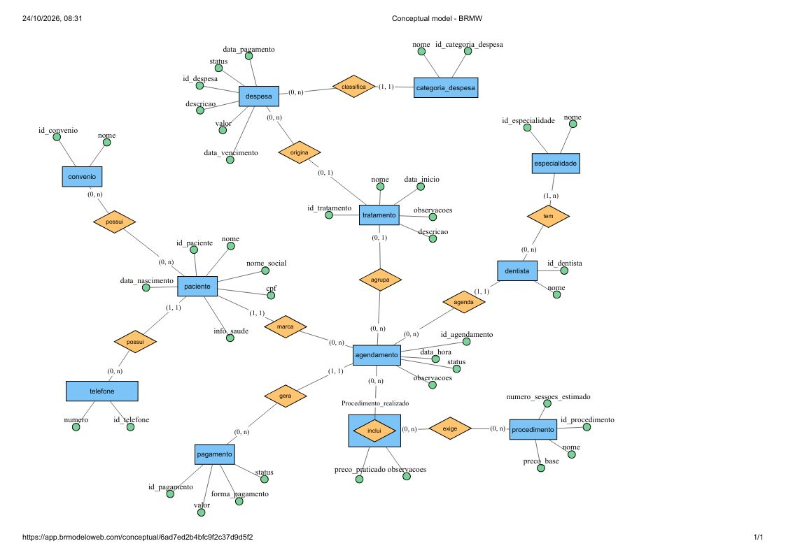

# Entrega 1 — Modelo Conceitual (DER)
### Modelagem de um sistema de gestão de informações para uma organização de pequeno porte

---

## Metadados

- **Nomes dos alunos e RGM:**
- Beatriz Fonseca Dias 47272139
- Vitória Aparecida de Assis Silva 46625909
- Letícia Santos da Silva 47551976

---

## 1. Caracterização da Organização

- **Nome e natureza da organização:** Clínica Sued Odontologia Humanizada — clínica odontológica particular, com fins lucrativos, atualmente em processo de implantação de atendimento por convênio (1 convênio).
- **Contexto e porte:** clínica em funcionamento há 6 meses. Estrutura enxuta: 1 sala de atendimento e 1 funcionária (a própria dentista responsável, Tamires, que também acumula a função de recepção/agendamento). Atende cerca de 20 pacientes cadastrados, com uma média de 7 atendimentos por semana. Os serviços oferecidos incluem atendimento clínico geral, implantes e próteses, além de outros procedimentos como limpeza, cirurgia, endodontia e clareamento.
- **Problemas e necessidades identificados:** as informações da clínica hoje estão divididas entre um aplicativo criado com apoio de IA e fichas clínicas físicas. O prontuário do paciente é mantido apenas em papel (ficha física + ficha de evolução), o que dificulta a consulta rápida do histórico. O agendamento é feito manualmente via WhatsApp e conferido no Google Agenda, sem sistema de bloqueio automático de horários. Não há controle financeiro sistematizado — o pagamento não é registrado em nenhum sistema, apenas mencionado no prontuário físico. Também não existe controle formal de estoque de materiais. A dona relatou como maior necessidade ter um "prontuário eletrônico" e otimizar a busca de pacientes e o controle financeiro.
- **Justificativa da escolha:** a clínica é pequena o suficiente para ser modelada nesta etapa (poucos profissionais, processos ainda simples), mas já gera entidades e relacionamentos suficientes para um modelo relevante: pacientes, dentistas, agendamentos, atendimentos, procedimentos, tratamentos e pagamentos. Além disso, por ser uma operação recém-criada e ainda sem sistema informatizado estruturado, o grupo tem espaço real para propor melhorias que a própria clínica já demonstrou desejar (prontuário eletrônico, busca rápida, controle financeiro).
- **Evidências da organização:**
  - **Endereço:** Praça Nelson Sales de Abreu, 103 - Sl 04, Cidade Patriarca, São Paulo - SP, CEP 03547-100
  - **Telefone de contato:** (11) 95387-7504
  - **Localização no Google Maps:** [maps.app.goo.gl/E1UdxAZoc6zMUEYx5](https://maps.app.goo.gl/E1UdxAZoc6zMUEYx5)
  - **Responsável pela organização:** Tamires (dentista e proprietária da clínica)
  - **Foto da visita de campo:**

    

---

## 2. Processos de Negócio

**Principais processos mapeados:**

1. **Cadastro de paciente** — feito por meio de anamnese física no primeiro atendimento; coleta dados pessoais e informações de saúde relevantes. Nome e telefone são obrigatórios; o paciente pode ter mais de um telefone de contato. O cadastro pode ser alterado posteriormente.
2. **Agendamento de consulta** — o paciente entra em contato via WhatsApp (é o único canal, exceto presencialmente com agendamento prévio); a própria dentista realiza o agendamento, verificando disponibilidade no Google Agenda. Em caso de cancelamento, é oferecido reagendamento; em caso de falta, a clínica entra em contato para saber o motivo e reagendar.
3. **Atendimento** — o paciente é recepcionado e avaliado pela própria dentista, que confirma a chegada. Durante o atendimento são registrados os procedimentos realizados e observações. Um atendimento pode envolver mais de um procedimento.
4. **Planejamento do tratamento e definição de valores** — na avaliação, a dentista define os procedimentos a realizar. Alguns procedimentos exigem outro antes (pré-requisito) e outros precisam de várias sessões. Cada procedimento tem um preço, que pode variar conforme o paciente ou a situação; a quantidade de pagamentos e a forma de pagar dependem do que é combinado com o paciente. O plano de tratamento é apresentado ao paciente antes do início e registrado, junto com o tratamento completo, na ficha de anamnese e na ficha de evolução (ambas em papel).
5. **Acompanhamento de tratamento** — quando o paciente precisa de múltiplos atendimentos ao longo do tempo (ex.: tratamento de canal, implante), a evolução é registrada em uma ficha de evolução física.
6. **Encaminhamento a dentista parceiro** — quando o paciente precisa de uma especialização diferente da dentista titular, um profissional parceiro realiza o atendimento.
7. **Pagamento** — pode ocorrer antes ou depois do atendimento, à vista ou parcelado, em pix, crédito, débito ou dinheiro. Não há registro sistematizado, o controle é feito apenas por meio do prontuário físico.
8. **(Processo em implantação) Convênios** — a clínica está iniciando o atendimento por convênio; as regras específicas (autorização de procedimentos, múltiplos convênios por paciente etc.) ainda não estão consolidadas.
9. **Compra e controle de materiais (não formalizado)** — segundo a entrevista, a clínica não mantém estoque formal, não controla materiais por quantidade mínima e não tem fornecedores cadastrados. Quando há entrada ou uso de materiais, o registro é feito pela própria dentista. "Abastecimento" foi citado pela responsável entre os pontos que gostaria de melhorar. Por não existir controle hoje, o processo está mapeado como necessidade futura e **não** entra no DER desta entrega.
10. **Controle financeiro e contas a pagar** — as despesas da clínica (fornecedores, materiais, aluguel) são controladas em uma planilha simples. O controle financeiro foi apontado como prioridade pela responsável. Como a planilha é externa ao prontuário e os pagamentos recebidos não são registrados em sistema, esse processo não foi modelado no DER desta entrega e fica previsto para etapa futura.
11. **Termos de consentimento (em papel)** — a clínica utiliza termo de consentimento para procedimentos cirúrgicos e para a entrega de trabalho e, em alguns casos, termo de direito de imagem.
12. **Recibo ou nota fiscal** — a clínica emite o documento somente quando o paciente solicita.

**O que a clínica não possui hoje:**

- Estoque de materiais, quantidade mínima de materiais e fornecedores cadastrados: a clínica não possui nenhum dos três.
- Registro de pagamentos em sistema: a clínica não possui; o controle é feito no prontuário em papel.
- Prontuário e histórico eletrônicos: a clínica não possui; o histórico é apenas físico.
- Identificador único de paciente: a clínica não possui; a identificação é pelo nome.
- Relatórios: a clínica não gera nenhum.
- Dados cadastrais do dentista além do nome: a clínica não registra.
- Regras de convênio (autorização de procedimentos e mais de um convênio por paciente): a clínica ainda não definiu.

---

## 3. Requisitos do Sistema

### 3.1 Requisitos Funcionais

- RF01 — O sistema deve permitir cadastrar pacientes com, no mínimo, nome e telefone, admitindo mais de um telefone por paciente.
- RF02 — O sistema deve permitir registrar e consultar o histórico completo de atendimentos de um paciente.
- RF03 — O sistema deve permitir agendar consultas associando paciente, dentista, data e horário, impedindo que dois pacientes sejam agendados no mesmo horário com o mesmo dentista.
- RF04 — O sistema deve permitir marcar o status de um agendamento (confirmado, cancelado, remarcado, não compareceu).
- RF05 — O sistema deve permitir registrar um atendimento vinculado a um ou mais procedimentos realizados.
- RF06 — O sistema deve permitir cadastrar procedimentos com preço base, número estimado de sessões e, quando aplicável, procedimento(s) pré-requisito(s).
- RF07 — O sistema deve permitir agrupar atendimentos de um mesmo paciente em um tratamento, com acompanhamento de evolução.
- RF08 — O sistema deve permitir registrar pagamentos vinculados a um atendimento, admitindo múltiplos pagamentos (parcelamento) e múltiplas formas de pagamento.
- RF09 — O sistema deve permitir identificar pagamentos pendentes.
- RF10 — O sistema deve permitir cadastrar dentistas com uma ou mais especialidades.
- RF11 — O sistema deve permitir buscar rapidamente um paciente pelo nome ou telefone.
- RF12 — O sistema deve permitir associar um paciente a um ou mais convênios, ou a nenhum (paciente particular).
- RF13 — O sistema deve permitir consultar os procedimentos já realizados em um paciente, para subsidiar novos agendamentos.

### 3.2 Requisitos Não Funcionais

- RNF01 — **Usabilidade:** interface simples, já que o sistema será operado por uma única profissional sem apoio técnico dedicado.
- RNF02 — **Segurança e privacidade:** acesso às informações do paciente deve ser restrito à dentista responsável (ou a quem ela autorizar), dado o caráter sensível dos dados de saúde.
- RNF03 — **Disponibilidade:** o sistema deve estar acessível também por dispositivo móvel, já que o agendamento hoje é feito por WhatsApp fora do horário fixo de clínica.
- RNF04 — **Desempenho:** buscas de paciente e consulta de dados financeiros devem retornar resultados rapidamente, atendendo à necessidade relatada de "otimizar a busca de pacientes e financeiro".
- RNF05 — **Confiabilidade:** os dados de prontuário não podem ser perdidos, dado que hoje existe dependência de ficha física.
- RNF06 — **Conformidade legal:** o sistema deve respeitar a LGPD para dados de saúde (dado pessoal sensível), manter o registro de acessos e preservar o prontuário pelo prazo de guarda de 20 anos, com anonimização após o prazo.

---

## 4. Regras de Negócio

**Regras operacionais:**

- Um paciente só pode ser cadastrado com, no mínimo, nome e telefone preenchidos.
- Um mesmo horário não pode ter dois pacientes agendados com o mesmo dentista (exclusividade horário × dentista).
- Um dentista pode ter várias consultas marcadas no mesmo dia.
- Em caso de cancelamento, é oferecido reagendamento; em caso de falta, a clínica contata o paciente para entender o motivo e propor novo horário.
- Caso o procedimento necessário exija uma especialidade diferente da dentista titular, o paciente é encaminhado a um dentista parceiro.
- Um agendamento pode envolver mais de um procedimento.
- Um procedimento pode exigir a realização prévia de outro procedimento (ex.: pré-requisito clínico antes de um implante).
- O preço de um procedimento é variável e pode mudar conforme o paciente ou a situação clínica; por isso o preço efetivamente praticado é registrado a cada procedimento realizado.
- Um agendamento pode pertencer a no máximo um tratamento, e pode não pertencer a nenhum (ex.: avaliação inicial).
- Um atendimento pode ser pago em mais de uma vez (parcelamento), inclusive combinando formas de pagamento diferentes.
- O pagamento pode ocorrer antes ou depois do atendimento.
- Quando há pagamento pendente, a clínica notifica o paciente.

**Restrições organizacionais:**

- A estrutura atual (1 sala, 1 dentista fixa) limita a quantidade de atendimentos simultâneos; isso importa para o modelo porque não há, hoje, necessidade de representar múltiplas salas, mas o modelo deve permitir essa expansão futura.
- O acesso às informações do paciente é restrito exclusivamente à dentista; é uma restrição de privacidade que deve ser preservada no sistema.
- Não existe, atualmente, identificador único formal por paciente (a identificação é feita por nome); isso é um risco de duplicidade que o modelo corrige ao propor uma chave primária gerada pelo sistema.
- **Guarda do prontuário:** o prontuário deve ser guardado por 20 anos; encerrado o prazo, os dados são anonimizados, nunca apagados fisicamente. Importa para o modelo porque os registros de paciente, tratamento e agendamento não podem ser excluídos.
- **LGPD — dado sensível de saúde:** as informações de saúde do paciente são dado pessoal sensível (LGPD, art. 5º, II e art. 11); o acesso é restrito aos envolvidos no cuidado e deve ficar registrado em log de acesso.
- **Consentimento do paciente:** a clínica usa termo de consentimento em papel para procedimentos cirúrgicos e para a entrega de trabalho e, em alguns casos, termo de direito de imagem. Os termos não são representados no DER desta entrega.
- **Documento fiscal:** a clínica emite recibo ou nota fiscal somente quando o paciente solicita. Não há controle de emissão e o documento não é representado no DER desta entrega.
- **Convênio:** o atendimento por convênio está em implantação; as regras de autorização de procedimentos pelo convênio e de múltiplos convênios por paciente ainda **não estão definidas** pela clínica. Por isso o modelo trata essa entidade de forma enxuta, pensando em expansão posterior.

---

## 5. Dicionário de Dados Conceitual (Preliminar)

📄 **[Dicionário de Dados (HTML)]([https://bia12diasfonseca-cyber.github.io/Entrega-1-Banco-de-dados/dicionario_dados.html])**

---

## 6. Modelagem Conceitual (Entidades, Atributos, Relacionamentos)

**Entidades reconhecidas:**

- **Paciente** — pessoa física atendida pela clínica; entidade central do modelo.
- **Convênio** — plano/operadora ao qual o paciente pode estar vinculado; entidade separada por poder ser compartilhada entre vários pacientes.
- **Telefone** — contato do paciente; entidade separada porque um paciente pode ter mais de um telefone.
- **Dentista** — profissional responsável pelos agendamentos e tratamentos.
- **Especialidade** — área de atuação odontológica; entidade separada porque um dentista pode ter mais de uma e uma mesma especialidade é compartilhada por vários dentistas.
- **Tratamento** — conjunto de cuidados conduzido por um dentista para um paciente, acompanhado ao longo de vários agendamentos.
- **Agendamento** — evento de marcação de consulta entre um paciente e um dentista; depois de realizado, representa o atendimento.
- **Procedimento** — serviço odontológico oferecido pela clínica (limpeza, cirurgia, manutenção, endodontia, implante, prótese, clareamento), com preço base.
- **Procedimento_Realizado** *(entidade associativa)* — registra cada procedimento executado em um agendamento, com o preço efetivamente praticado.
- **Pagamento** — registro financeiro gerado a partir de um agendamento.

**Atributos e classificações** *(conforme o DER anexado):*

- **Paciente:** `id_paciente` (chave primária, simples); `nome` (simples, obrigatório); `nome_social` (simples, opcional); `cpf` (simples, opcional, único quando informado); `data_nascimento` (simples, opcional); `info_saude` (simples, opcional, dado sensível de acesso restrito).
- **Convênio:** `id_convenio` (chave primária, simples); `nome` (simples, obrigatório).
- **Telefone:** `id_telefone` (chave primária, simples); `numero` (simples, obrigatório).
- **Dentista:** `id_dentista` (chave primária, simples); `nome` (simples, obrigatório).
- **Especialidade:** `id_especialidade` (chave primária, simples); `nome` (simples, obrigatório).
- **Tratamento:** `id_tratamento` (chave primária, simples); `nome` (simples, obrigatório); `data_inicio` (simples, opcional); `descricao` (simples, opcional); `observacoes` (simples, opcional).
- **Agendamento:** `id_agendamento` (chave primária, simples); `data_hora` (simples, obrigatório); `status` (simples, categórico: agendado, realizado, cancelado, remarcado, não compareceu); `observacoes` (simples, opcional).
- **Procedimento:** `id_procedimento` (chave primária, simples); `nome` (simples, obrigatório); `preco_base` (simples, obrigatório); `numero_sessoes_estimado` (simples, opcional).
- **Procedimento_Realizado** (associativa; identificada pelas chaves de Agendamento e Procedimento): `preco_praticado` (simples, obrigatório); `observacoes` (simples, opcional).
- **Pagamento:** `id_pagamento` (chave primária, simples); `valor` (simples, obrigatório); `forma_pagamento` (simples, categórico: pix, crédito, débito, dinheiro); `status` (simples, categórico: pago, pendente); `observacoes` (simples, opcional).

Não há atributos compostos nem multivalorados no modelo. Os dois casos que poderiam ser multivalorados (telefones do paciente e especialidades do dentista) foram resolvidos como entidades próprias relacionadas. A idade do paciente é derivável de `data_nascimento` e, por isso, não é armazenada.

**Relacionamentos pertinentes:**

As cardinalidades seguem o formato (mín,máx) do DER, lidas "do outro lado": o par ao lado de uma entidade indica quantas ocorrências **dela** se associam a **uma** ocorrência da entidade oposta.

| Relacionamento | Entidade A | Entidade B | Leitura |
|---|---|---|---|
| **possui** | Paciente (0,n) | Convênio (0,n) | Um paciente tem zero ou mais convênios (zero = particular); um convênio tem zero ou mais pacientes (N:N). |
| **possui** | Paciente (1,1) | Telefone (1,n) | Um paciente tem de um a vários telefones; cada telefone pertence a exatamente um paciente. |
| **possui** | Paciente (1,1) | Tratamento (0,n) | Um paciente tem zero ou vários tratamentos; cada tratamento é de um único paciente. |
| **marca** | Paciente (1,1) | Agendamento (0,n) | Um paciente tem zero ou vários agendamentos; cada agendamento é de um único paciente. |
| **agenda** | Dentista (1,1) | Agendamento (0,n) | Um dentista tem zero ou vários agendamentos; cada agendamento é com um único dentista. |
| **realiza** | Dentista (1,1) | Tratamento (0,n) | Um dentista realiza zero ou vários tratamentos; cada tratamento tem um único dentista responsável. |
| **tem** | Dentista (0,n) | Especialidade (1,n) | Um dentista tem de uma a várias especialidades; uma especialidade pode ter zero ou vários dentistas (N:N). |
| **agrupa** | Tratamento (0,1) | Agendamento (0,n) | Um tratamento agrupa zero ou vários agendamentos; cada agendamento pertence a no máximo um tratamento. |
| **inclui** (associativa Procedimento_Realizado) | Agendamento (0,n) | Procedimento (0,n) | Um agendamento inclui zero ou vários procedimentos; um procedimento pode aparecer em zero ou vários agendamentos (N:N), com o preço praticado na associativa. |
| **exige** (auto-relacionamento) | Procedimento (0,n) | Procedimento (0,n) | Um procedimento exige zero ou vários procedimentos prévios; pode ser pré-requisito de zero ou vários outros (N:N). |
| **gera** | Agendamento (1,1) | Pagamento (0,n) | Um agendamento gera zero ou vários pagamentos (parcelamento); cada pagamento vem de um único agendamento. |

**Restrições e políticas organizacionais aplicadas ao modelo:**

- Todo paciente deve ter ao menos um telefone de contato (mínimo 1 do lado Telefone).
- O vínculo com convênio é opcional — paciente sem convênio é tratado como particular.
- Todo agendamento está associado a exatamente um paciente e um dentista, e a no máximo um tratamento.
- Todo dentista deve ter ao menos uma especialidade cadastrada (mínimo 1 do lado Especialidade).
- Um procedimento não pode ser pré-requisito de si mesmo.
- A exclusividade de horário (mesmo dentista, mesma data e hora) não é expressa por cardinalidade; é uma regra de integridade a ser garantida na implementação.
- O acesso à informação de saúde (`info_saude`) é restrito à dentista responsável.
- Registros de paciente, tratamento e agendamento não são excluídos durante o prazo de guarda do prontuário (20 anos).

---

## 7. Diagrama Entidade-Relacionamento (DER)

 

  

---

## 8. Justificativa Técnica

- **Agendamento como entidade única para a consulta marcada e realizada:** não foi criada uma entidade Atendimento separada. Como a clínica tem uma única dentista e uma sala, cada consulta marcada vira, quando ocorre, o atendimento; a situação (agendado, realizado, cancelado, remarcado, não compareceu) já registra cancelamentos e faltas relatados na entrevista. Duas entidades quase idênticas duplicariam dados sem ganho para o modelo.
- **Procedimento como entidade própria, e não como atributo do agendamento:** a entrevista confirmou que um atendimento pode envolver vários procedimentos, que cada um tem preço, que alguns exigem outro antes e que alguns têm várias sessões. Um atributo de texto não permitiria vários procedimentos por agendamento, nem preço base ou pré-requisitos.
- **Entidade associativa Procedimento_Realizado:** a relação entre Agendamento e Procedimento é N:N e carrega um dado que pertence à combinação, não a cada lado: o preço efetivamente praticado, que pode variar por paciente ou situação. Por isso a associativa tem atributos próprios (`preco_praticado`, `observacoes`).
- **Auto-relacionamento "exige" em Procedimento:** representa os pré-requisitos (ex.: um procedimento antes de um implante) sem duplicar entidades. É N:N porque um procedimento pode exigir vários e ser exigido por vários.
- **Tratamento ligado a Paciente, Dentista e Agendamento:** a clínica acompanha a evolução de tratamentos de várias sessões em uma ficha de evolução. Ligar Tratamento a Agendamento (0,1 : 0,n) permite agrupar as sessões de um tratamento e, ao mesmo tempo, aceitar agendamentos fora de tratamento, como a avaliação inicial. Os procedimentos de um tratamento são obtidos a partir dos agendamentos agrupados, sem relacionamento direto adicional que seria redundante.
- **Pagamento como entidade própria:** como um atendimento pode ser pago em mais de uma vez e com formas diferentes, tratar pagamento como atributo do agendamento impediria representar parcelamento. A entidade, relacionada 1:N ao agendamento, resolve isso.
- **Telefone, Especialidade e Convênio como entidades:** representar esses dados como atributos multivalorados repetiria valores no mesmo registro. Como entidades, telefone é 1:N com paciente, e convênio e especialidade são N:N, o que atende a regra de que um dentista pode ter mais de uma especialidade.
- **Convênio enxuto:** como o atendimento por convênio ainda está em implantação e suas regras não foram definidas, a entidade guarda apenas identificação e nome, o que evita modelar regras hipotéticas e deixa espaço para expansão.
- **Identificadores únicos e CPF opcional:** a clínica identifica pacientes só pelo nome, o que gera risco de duplicidade; por isso cada entidade tem chave primária gerada pelo sistema. O `cpf` foi incluído como atributo opcional e único para ajudar a distinguir homônimos, sem torná-lo obrigatório, já que a clínica só exige nome e telefone (e dado desnecessário amplia o risco na LGPD).
- **Itens fora do DER desta entrega:** a clínica não possui estoque formal nem fornecedores cadastrados, controla despesas em planilha simples, usa termos de consentimento em papel e emite recibo ou nota fiscal só sob solicitação. Modelar essas entidades criaria dados que a clínica não registra hoje. Os processos estão mapeados na Seção 2 e podem ser incorporados depois, sem alterar as entidades atuais.

---

## 9. Uso de Inteligência Artificial

| Item | Registro |
|------|------------------|
| **Ferramenta e etapa** | Claude (Anthropic), utilizado na organização das respostas da entrevista de campo e na redação do README (caracterização da organização, requisitos, regras de negócio, dicionário de dados, modelagem conceitual e justificativa técnica). |
| **Motivação** | O grupo já havia realizado a entrevista presencial na clínica e precisava estruturar as respostas no formato exigido pelo esqueleto do README, incluindo a identificação de entidades, atributos e cardinalidades a partir das respostas obtidas. |
| **Prompt(s) utilizados** | 1) "Você pode me ajudar com um trabalho? Preciso fazer um README seguindo as orientações que estão no arquivo da atividade. Vou te enviar esse arquivo e, depois, a entrevista que fiz com a empresa. Quero que você analise o que a atividade pede e me diga quais informações você precisa da entrevista ou de outras fontes para conseguir montar o README corretamente." 2) "Essa é a entrevista que eu fiz com a empresa. Analise as informações e veja se elas são suficientes para fazer o README seguindo o que a atividade pede. Se estiver faltando alguma informação, me avise exatamente o que preciso fornecer." |
| **Resposta recebida** | A IA solicitou inicialmente as informações necessárias (nome/tipo da organização, evidências de existência, processos, regras e dados coletados) e, após o envio da entrevista, gerou uma proposta de README completo, incluindo entidades, atributos, relacionamentos e cardinalidades derivados das respostas da entrevista. |
| **Fontes consultadas e verificadas** | Nenhuma fonte externa foi usada, todo o conteúdo foi derivado exclusivamente das respostas da entrevista de campo feita pelo próprio grupo na clínica. |
| **Trechos rejeitados ou corrigidos** | O grupo revisou tudo o que a IA gerou, comparando com o que foi observado na visita de campo. Um dos trechos corrigidos foi na parte de atributos das entidades, onde alguns campos sugeridos pela IA foram ajustados para refletir melhor a realidade da clínica. |
| **Justificativa da escolha final** | O grupo adaptou algumas partes sugeridas pela IA porque, com o conhecimento direto da clínica obtido na visita, entendeu que do jeito que o grupo pensou o modelo ficaria mais fiel à realidade observada. |
| **Reflexão crítica** | A IA não teve acesso direto à clínica, apenas ao texto da entrevista, por isso, atributos como `data_nascimento` e `id_paciente` foram propostos como recomendações de boas práticas de modelagem, não como dados hoje efetivamente coletados pela clínica, e devem ser validados pelo grupo. Há também risco de a IA ter generalizado processos comuns a clínicas odontológicas que não necessariamente se aplicam a esta clínica específica (ex.: regras de convênio, que ainda estão em implantação e não foram detalhadas na entrevista). |

---

## Resumo dos Pesos

| Dimensão | Peso total |
|----------|-----------|
| Conceitual (contexto, requisitos/regras, modelagem, justificativa técnica) | 30% |
| Procedimental (requisitos, fluxogramas, dicionário de dados, DER) | 50% |
| Atitudinal (participação, comprometimento, colaboração, autonomia) | 20% |

**Entrega final:** README.md completo + DER + Dicionário de Dados em HTML (com exceção dos cursos GTI) anexado no repositório GitHub do grupo.
