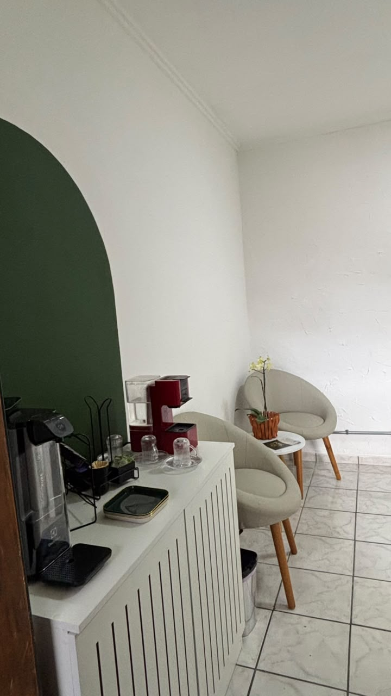
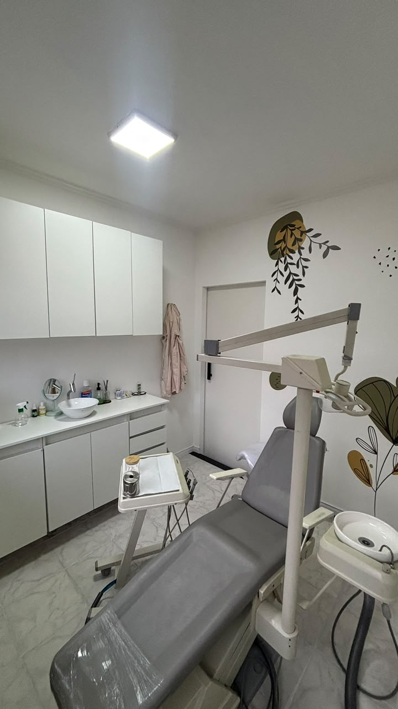

# Levantamento de Requisitos e Análise Operacional

**Organização:** Clínica Sued Odontologia Humanizada  
**Disciplina:** Modelagem de Banco de Dados — Entrega 2  
**Arquivo do Repositório:** `levantamento/levantamento.md`  

---

## 1. Identificação e Caracterização da Organização

* **Nome Fantasia:** Clínica Sued Odontologia Humanizada
* **Ramo de Atuação:** Prestação de Serviços de Saúde Odontológica
* **Atividade Principal:** Atendimento clínico odontológico geral, procedimentos de implantodontia, confecção e entrega de próteses, clareamento e manutenção preventivo-restauradora.
* **Porte e Números Operacionais:**
  * **Volume Médio de Atendimentos:** Aprox. 7 atendimentos por semana (capacidade física/agenda para expansão).
  * **Base de Histórico de Pacientes:** Aprox. 20 pacientes cadastrados no histórico físico/arquivos acumulados.
  * **Estrutura Física e Equipamentos:** 1 sala de atendimento ativa equipada com cadeira odontológica (equipo).
  * **Equipe Operacional Interna:** 1 cirurgiã-dentista responsável (atuando também na gestão)
  * **Tempo de Existência:** 6 meses de funcionamento nas instalações atuais.
* **Dados do Responsável Entrevistado e Validação:**
  * **Responsável Técnica / Gestora:** Dra. Tamires Pereira (Cirurgiã-Dentista e Proprietária).
  * **Telefone de Contato da Clínica:** (11) 95387-7504 *(contato informado na entrevista de campo)*.
* **Endereço:** Praça Nelson Sales de Abreu, 103 - Sl 04, Cidade Patriarca, São Paulo - SP, CEP 03547-100.
* **Presença Digital e Evidência:** 
  * **Perfil no Google Meu Negócio:** a responsável informou que a clínica possui perfil no Google Meu Negócio. A ficha da empresa pode ser vista no Google Maps: [Clínica Sued Odontologia Humanizada no Google Maps](https://maps.app.goo.gl/E1UdxAZoc6zMUEYx5).
* **Declaração de Vínculo do Grupo:** a integrante **Letícia Santos da Silva** tem parentesco com a proprietária da clínica, a Dra. Tamires: são **primas**. Declaramos o vínculo por transparência. A pesquisa de campo foi feita por entrevista e observação presencial, como descrito na seção 2, e o parentesco não substitui esse levantamento. Nenhum outro integrante do grupo tem vínculo com a organização.
 

---

## 2. Detalhes da Entrevista de Campo e Evidências

* **Data e Hora da Entrevista:** 24 de outubro de 2026.
* **Local:** Instalações físicas da Clínica Sued Odontologia Humanizada.
* **Entrevistada:** Dra. Tamires Pereira (Cirurgiã-Dentista / Gestora).
* **Participantes do Grupo:** Letícia Santos da Silva
* **Evidências Fotográficas:**
  * **Foto da visita de campo:**     

  * **Foto da clínica (ambiente e instalações):**
 
    

    

---

## 3. Funcionamento Atual dos Processos Operacionais

A rotina diária da clínica desdobra-se em cinco fluxos de trabalho principais:

1. **Recepção e Cadastro de Pacientes:**
   * O primeiro contato ocorre predominantemente via WhatsApp ou telefone.
   * Na recepção presencial, coleta-se o cadastro básico do paciente. Pela regra da clínica (RN01), exige-se obrigatoriamente o `nome` e ao menos um `numero` de telefone (armazenado na tabela `telefone`).
   * Quando disponibilizados, preenchem-se `cpf`, `data_nascimento`, `nome_social` e histórico de `info_saude` (anamnese clínica).
   * Caso o paciente pertença a uma operadora de saúde (a clínica está em fase de implantação de convênios), vincula-se o paciente na associativa `paciente_convenio` ao respectivo `convenio`. Pacientes sem convênio são tratados como particulares.

2. **Agendamento e Controle de Consultas:**
   * A recepção verifica a disponibilidade da dentista utilizando o Google Agenda e o controle manual da profissional.
   * O `agendamento` é registrado associando obrigatoriamente o `id_paciente`, `id_dentista`, a `data_hora` e o `status` inicial ("agendado").
   * Quando a consulta faz parte de um ciclo contínuo de cuidados, vincula-se ao respectivo `id_tratamento`.
   * Em casos de cancelamento ou não comparecimento, atualiza-se o `status` no sistema e oferta-se novo horário ao paciente.

3. **Atendimento Clínico e Lançamento de Procedimentos:**
   * Durante a consulta, a dentista realiza o procedimento e anota a evolução na ficha física de papel.
   * No banco de dados, o atendimento concluído gera o registro na entidade associativa `procedimento_realizado`, ligando o `id_agendamento` ao `id_procedimento` (consultado do catálogo `procedimento`).
   * Salva-se o `preco_praticado` (que pode diferir do `preco_base` por conta de concessões ou especificidades clínicas) e atualiza-se o status do agendamento para "realizado".

4. **Faturamento, Pagamento e Controle Financeiro:**
   * Os pagamentos podem ser efetuados antes ou após o atendimento, em Pix, cartão de crédito, cartão de débito ou dinheiro.
   * A clínica permite o parcelamento ou pagamento fracionado de atendimentos. Cada parcela ou valor recebido/devido gera um registro na tabela `pagamento`, contendo `valor`, `forma_pagamento` e `status` ("pago" ou "pendente").
   * Recibos ou notas fiscais são emitidos exclusivamente quando solicitados pelo paciente.

5. **Gestão de Despesas Operacionais:**
   * As despesas da clínica são organizadas por meio de uma planilha de controle e registradas na entidade `despesa`.
   * Cada gasto é associado obrigatoriamente a uma `categoria_despesa` (*aluguel*, *luz*, *impostos*, *laboratorios*, *dental*, *emprestimos* ou *gastos_eventuais*).
   * Despesas diretamente originadas por um tratamento de paciente (como a confecção de próteses em laboratórios de prótese parceiros) são vinculadas ao respectivo `id_tratamento`.

---

## 4. Problemas Identificados (P1 a P6)

Os problemas operacionais mapeados na entrevista e na observação presencial que fundamentam a solução de banco de dados são:

* **[P1] Prontuário e Histórico Clínico Apenas em Papel:** As fichas de anamnese e de evolução são guardadas exclusivamente em papel, o que dificulta consultar o histórico de procedimentos do paciente e deixa as informações de saúde (dado sensível, LGPD) sem restrição formal de acesso por perfil e sem trilha de auditoria.
* **[P2] Agendamento Manual:** A agenda é controlada pelo Google Agenda e pelo controle manual da dentista, sem validação automática. Há risco de agendamento duplo para o mesmo dentista na mesma data e hora, e cancelamentos e faltas ficam sem acompanhamento sistemático.
* **[P3] Pagamentos sem Registro:** Pagamentos parcelados, entradas e saldos pendentes são anotados de modo informal em fichas e cadernos, sem controle centralizado de quem deve e quanto.
* **[P4] Busca Lenta de Pacientes e do Financeiro:** Os pacientes são identificados apenas pelo nome em fichas físicas, sem identificador único (homônimos) e com telefones sem padronização. Localizar um paciente ou sua situação financeira exige consultar papéis.
* **[P5] Captação de Clientes (atendido parcialmente):** A clínica não registra a origem dos pacientes (marketing, indicação) nem acompanha quantos pacientes avaliados passam a fazer tratamento ou ficam muito tempo sem retorno. O modelo atende apenas a parte de conversão em tratamento e de inatividade, pois a origem do paciente está fora do escopo (seção 8, item 5).
* **[P6] Despesas em Planilha Separada:** As despesas são controladas em planilha simples, sem vínculo com os tratamentos que as originaram (como laboratório de prótese) e sem acompanhamento de vencimentos e contas a pagar, o que impede apurar o custo direto e a margem por tratamento.

---

## 5. Requisitos Funcionais (RF01 a RF13)

Os requisitos funcionais descritos refletem rigorosamente as entidades, atributos e relacionamentos definidos no Dicionário de Dados v1.2 e no DER/Modelo Lógico:

* **[RF01] Manter Cadastro de Pacientes:** O sistema deve cadastrar e atualizar dados do paciente na tabela `paciente`, exigindo obrigatoriamente `nome` (varchar 120) e permitindo o registro opcional de `nome_social` (varchar 120), `cpf` (char 11, único), `data_nascimento` (date) e `info_saude` (varchar 1000, dado sensível).
* **[RF02] Gerenciar Telefones do Paciente:** O sistema deve registrar os números de telefone do paciente na tabela `telefone`, exigindo o vínculo com `id_paciente` e o campo `numero` (varchar 20).
* **[RF03] Gerenciar Convênios e Vínculos de Pacientes:** O sistema deve registrar operadoras em `convenio` (`nome` varchar 100) e gerenciar a associação N:N na tabela de ligação `paciente_convenio` (`id_paciente`, `id_convenio`).
* **[RF04] Cadastrar Dentistas e Especialidades:** O sistema deve manter os dados em `dentista` (`nome` varchar 120) e associar obrigatoriamente a uma ou mais opções da tabela `especialidade` (`nome` varchar 60) através da tabela de ligação `dentista_especialidade`.
* **[RF05] Controlar Agendamentos de Consultas:** O sistema deve permitir agendar consultas na tabela `agendamento`, vinculando `id_paciente`, `id_dentista`, `data_hora` (datetime), `status` (varchar 15, com opções: *agendado*, *realizado*, *cancelado*, *remarcado*, *nao_compareceu*), e opcionalmente `id_tratamento` e `observacoes`.
* **[RF06] Gerenciar Planos de Tratamento:** O sistema deve permitir criar e acompanhar em `tratamento` os dados de `nome` (varchar 120), `data_inicio` (date), `descricao` (varchar 500) e `observacoes` (varchar 500).
* **[RF07] Lançar Procedimentos no Atendimento:** O sistema deve consultar o catálogo `procedimento` (`nome`, `preco_base`, `numero_sessoes_estimado`) e registrar os serviços executados na entidade associativa `procedimento_realizado`, capturando `preco_praticado` (decimal 10,2) e `observacoes`.
* **[RF08] Registrar e Dar Baixa em Pagamentos:** O sistema deve registrar o fluxo financeiro de entradas na tabela `pagamento` para um agendamento, especificando `valor` (decimal 10,2), `forma_pagamento` (*pix*, *credito*, *debito*, *dinheiro*) e `status` (*pago*, *pendente*).
* **[RF09] Gerenciar Categorias e Lançamentos de Despesas:** O sistema deve manter os tipos em `categoria_despesa` (`nome` varchar 30) e cadastrar em `despesa` o `id_categoria_despesa`, `valor` (decimal 10,2), `data_vencimento`, `data_pagamento` (opcional), `status` (*pendente*, *paga*), `descricao` e o vínculo opcional com `id_tratamento`.
* **[RF10] Implementar Log de Acesso e Segurança (LGPD):** O sistema deve ocultar o campo `info_saude` para perfis de recepcionista/financeiro e o SGBD deve gravar log de auditoria operacional para todas as operações de leitura e modificação nas tabelas do banco de dados.
* **[RF11] Buscar Pacientes:** O sistema deve permitir localizar rapidamente um paciente por `nome`, `nome_social`, `cpf` ou `numero` de telefone.
* **[RF12] Consultar Situação Financeira:** O sistema deve permitir consultar pagamentos pendentes por paciente, despesas pendentes e vencidas, e o resultado financeiro mensal (recebido menos despesas pagas).
* **[RF13] Consultar Histórico de Procedimentos do Paciente:** O sistema deve listar os procedimentos já realizados em um paciente (`procedimento_realizado`), com a quantidade de vezes e a data da última realização, para apoiar novos agendamentos.

---

## 6. Regras de Negócio (RN01 a RN27)

As regras de negócio do levantamento seguem a mesma numeração usada no Dicionário de Dados v1.2 e no script SQL.

* **[RN01] Cadastro Mínimo Obrigatório do Paciente:** Todo paciente deve possuir obrigatoriamente um `nome` cadastrado e ao menos um `numero` registrado na tabela `telefone`.
* **[RN02] Exclusividade de Horário na Agenda:** Um dentista não pode possuir mais de um agendamento cadastrado com a mesma `data_hora`, desconsiderando agendamentos cujo `status` seja igual a 'cancelado'.
* **[RN03] Validação de Data de Nascimento:** O campo `data_nascimento` na tabela `paciente` não pode aceitar datas posteriores à data atual de cadastro.
* **[RN04] Atualização da Situação do Agendamento:** Em caso de cancelamento, a clínica oferece novo horário ao paciente; em caso de falta, entra em contato com ele. A situação do agendamento deve sempre ser atualizada (*realizado*, *cancelado*, *nao_compareceu* ou *remarcado*).
* **[RN05] Profissionais Externos e Auxiliares Não Cadastrados:** Dentistas parceiros convidados e funcionários auxiliares não são cadastrados no banco; apenas a dentista titular consta em `dentista`.
* **[RN06] Procedimentos Somente em Atendimento Realizado:** Procedimentos e preços praticados só podem ser lançados em `procedimento_realizado` para agendamentos com `status` = 'realizado'; agendamentos cancelados não registram procedimentos.
* **[RN07] Unicidade do Nome de Especialidade:** Não é permitido cadastrar duas especialidades com o mesmo `nome` na tabela `especialidade`.
* **[RN08] Autonomia do Preço Praticado:** O valor do campo `preco_praticado` registrado em `procedimento_realizado` pode ser diferente do `preco_base` fixado no catálogo de procedimentos (concessões ou particularidades do caso).
* **[RN09] Consistência de Pertencimento do Tratamento:** Um agendamento só pode ser vinculado a um `id_tratamento` se o paciente do agendamento for o mesmo paciente proprietário do tratamento.
* **[RN10] Múltiplos Pagamentos por Agendamento:** Um agendamento pode possuir zero, um ou vários lançamentos na tabela `pagamento` (parcelas ou combinação de formas de pagamento), e a soma dos pagamentos não deve ultrapassar o valor dos procedimentos realizados.
* **[RN11] Positividade dos Preços de Procedimento:** Os valores informados em `preco_base` (`procedimento`) e `preco_praticado` (`procedimento_realizado`) devem ser maiores ou iguais a zero (`>= 0`).
* **[RN12] Aviso de Pagamento Pendente:** Quando há valores pendentes, a clínica avisa o paciente diretamente.
* **[RN13] Especialidade Obrigatória do Dentista:** Todo dentista cadastrado deve ter ao menos uma especialidade vinculada na tabela `dentista_especialidade`.
* **[RN14] Valor Positivo de Pagamento:** O campo `valor` na tabela `pagamento` deve ser estritamente maior que zero (`> 0`).
* **[RN15] Domínio de Formas de Pagamento Aceitas:** O campo `forma_pagamento` na tabela `pagamento` aceita apenas os valores `'pix'`, `'credito'`, `'debito'` e `'dinheiro'`.
* **[RN16] Regra para Data de Pagamento de Despesa:** O campo `data_pagamento` na tabela `despesa` só deve ser preenchido quando o `status` da despesa for `'paga'`.
* **[RN17] Status do Pagamento:** O campo `status` da tabela `pagamento` aceita estritamente os valores `'pago'` ou `'pendente'`.
* **[RN18] Classificação Obrigatória de Despesa:** Toda despesa lançada na tabela `despesa` deve possuir obrigatoriamente uma `id_categoria_despesa` associada.
* **[RN19] Unicidade e Formato do CPF:** O campo `cpf` do paciente é opcional; quando informado, deve conter exatamente 11 dígitos numéricos e ser único em todo o sistema.
* **[RN20] Retenção Legal de Prontuários:** Registros de anamnese, atendimentos e tratamentos devem permanecer armazenados pelo prazo legal de guarda de prontuários (20 anos), sendo proibida a exclusão física (`DELETE`) do registro no SGBD.
* **[RN21] Valor Positivo de Despesa:** O campo `valor` na tabela `despesa` deve ser estritamente maior que zero (`> 0`).
* **[RN22] Proteção e Restrição de Acesso a Dados de Saúde (LGPD):** O campo `info_saude` na tabela `paciente` é Dado Pessoal Sensível de Saúde (Art. 5º, II da LGPD), e seu acesso visual é restrito ao perfil de Dentista e Auditoria (a Recepção acessa o cadastro por meio de visão/view que omite a coluna sensível).
* **[RN23] Formatação de Número Telefônico:** O campo `numero` na tabela `telefone` deve aceitar apenas caracteres numéricos (10 ou 11 dígitos, englobando o DDD).
* **[RN24] Extensão para Novos Convênios:** Diante da fase inicial de credenciamento da clínica com operadoras, a estrutura da tabela `convenio` é mantida enxuta nesta versão (identificador e nome), permitindo expansão sem impactar o modelo lógico.
* **[RN25] Modalidade Particular por Padrão:** Pacientes que não possuem registros associados na tabela `paciente_convenio` são considerados atendimentos em modalidade Particular.
* **[RN26] Sessões Estimadas Válidas:** O campo `numero_sessoes_estimado` na tabela `procedimento`, quando preenchido, deve ser estritamente maior que zero (`> 0`).
* **[RN27] Vínculo Opcional de Despesa a Tratamento:** Despesas gerais de manutenção da clínica (aluguel, luz, impostos) mantêm `id_tratamento` nulo; despesas operacionais originadas por atendimentos específicos (como laboratórios de prótese) devem vincular o `id_tratamento` correspondente.

---

## 7. Observações Presenciais (Fatos Observados *In Loco*)

Durante a visita técnica às instalações da clínica, a equipe registrou e separou os seguintes fatos concretos presenciados das informações verbalizadas na entrevista:

* **Dinâmica de Recepção e Confirmação:** Observou-se que a confirmação dos pacientes do dia ocorre via mensagens pelo WhatsApp realizadas diretamente no balcão de recepção.
* **Anotações de Prontuário no Consultório:** Durante a consulta, a cirurgiã-dentista efetua anotações manuais dos procedimentos realizados em uma ficha física de evolução em papel disposta sobre a mesa do consultório.
* **Prática de Recebimentos Parciais:** Constatou-se que pacientes em tratamentos continuados de prótese/implante efetuam acertos parciais do valor total diretamente na recepção. O controle dessa inadimplência parcial ocorria por meio de anotações manuais em cadernos, confirmando a necessidade imediata dos campos `status` ('pendente'/'pago') na entidade `pagamento`.

---

## 8. Justificativa de Itens Mantidos Fora do Escopo

Em estrito alinhamento com a realidade apurada e as recomendações pedagógicas de modelagem do professor, os tópicos a seguir foram mantidos fora do escopo desta versão do banco de dados:

1. **Estoque de Insumos e Materiais Clínicos:** A clínica declarou não realizar controle automatizado de estoque de materiais (luvas, resinas, agulhas); o abastecimento ocorre por compra direta lançada como despesa na categoria `dental`.
2. **Cadastro Abrangente de Profissionais Externos e Auxiliares:** Dentistas parceiros pontuais (como especialistas em cirurgias complexas eventualmente convidados, por exemplo "dentistas parceiros convidados") e funcionários auxiliares não são cadastrados no banco de dados. O sistema mantém apenas a dentista titular responsável (`dentista`), com suas especialidades em `dentista_especialidade`.
3. **Pré-requisitos Obrigatórios Rígidos entre Procedimentos:** Conforme orientado pelo professor, a dependência prévia entre procedimentos (ex: necessidade de raspagem/limpeza prévia ao clareamento) permanece sob validação da camada de aplicação e julgamento clínico, sem modelagem de autorrelacionamento ou tabela de pré-requisito no banco de dados.
4. **Emissão de Notas Fiscais e Recibos Fiscais:** A clínica não possui integração fiscal e emite recibos apenas quando solicitados pontualmente, não havendo tabela para armazenar documentos fiscais emitidos.
5. **Rastreamento do Canal de Captação do Cliente:** Não há registro da origem comercial/marketing pelo qual o paciente conheceu a clínica.

---

## 9. Informações Pendentes de Confirmação

As lacunas mapeadas que não possuem impacto imediato na estrutura do modelo lógico atual, mas que dependem de confirmação futura junto à gestão da clínica, são:

1. **Atributos do Cadastro de Convênios:** Definição de campos adicionais (ex: código ANS, prazo de repasse e tabela de honorários) para quando o credenciamento de novos convênios estiver concluído.
2. **Tempo Médio de Duração dos Procedimentos:** Estipulação da duração média em minutos para cada serviço do catálogo `procedimento`, visando automação futura da agenda.
3. **Política de Rotação e Descarte de Logs do SGBD:** Periodicidade de exportação e arquivamento em storage externo dos logs de auditoria de acesso.
